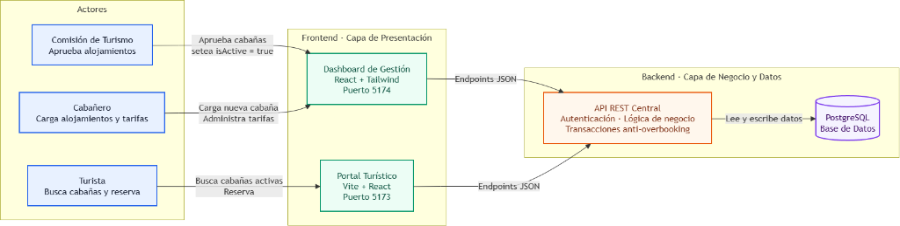
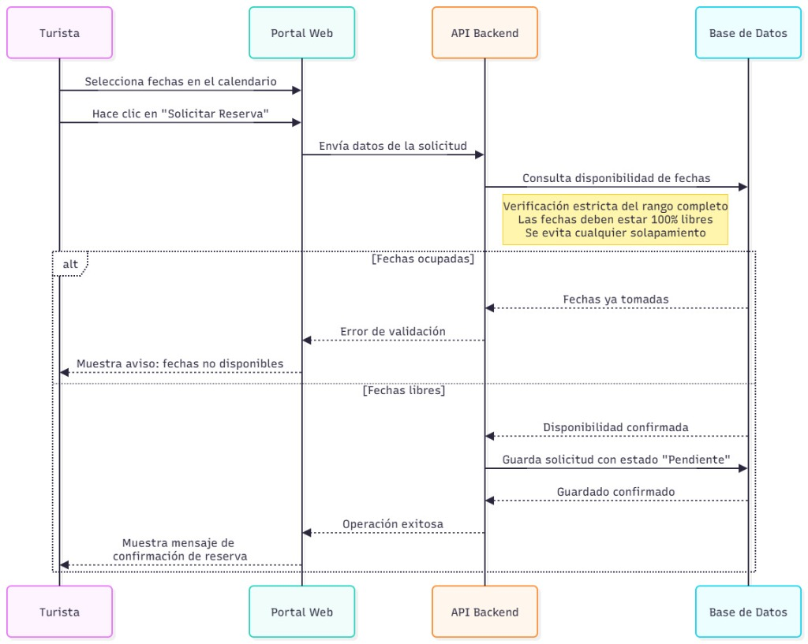

# Turismo Capilla del Monte — Portal Turístico & Reservas (Frontend)

<p align="center">
  
  
  
  
  
  
</p>

Plataforma web oficial para la promoción turística, catálogo de atractivos y motor de reservas directas de alojamientos en la localidad de **Capilla del Monte, Córdoba, Argentina**, desarrollada para la **Comisión de Turismo de Capilla del Monte**.

---

## 1. Arquitectura Multirepo del Proyecto

A continuación, se detalla el flujo de interacción de los distintos actores con las aplicaciones de la plataforma y su conexión unificada al cerebro central de datos.



* **Actores (El "Quién"):** Se diferencian tres perfiles clave. El **Turista** (usuario final público), el **Cabañero** (administrador de su oferta), y la **Comisión de Turismo** (ente regulador y aprobador).
* **Frontend (El "Dónde"):** La capa de presentación está dividida en dos aplicaciones. Un **Portal Turístico** público (Vite + React) orientado a conversión, y un **Dashboard de Gestión** privado (React + Tailwind).
* **Backend (El "Cerebro"):** Ambas aplicaciones consumen la misma **API REST Central** y base de datos, garantizando que cuando la Comisión aprueba una cabaña en el Dashboard, esta impacte instantáneamente en el Portal público.

El sistema se encuentra estructurado bajo una arquitectura **Multirepo** desacoplada en dos repositorios independientes:

1. **Frontend (Este Repositorio — `Turismo-Capilla`):**
   * **Tecnologías:** React 19.3, Vite 8 (Rolldown), React Router v7, Tailwind CSS v4, Lucide React, GSAP.
   * **Puertos por defecto:** Portal `http://localhost:5173` | Dashboard `http://localhost:5174`
   * **Responsabilidad:** Experiencia del turista, landing institucional, catálogo con filtros interactivos, visualización de mapas, motor de reservas y dashboards protegidos por rol.
2. **Backend (`backend-capilla-turismo`):**
   * **Tecnologías:** Java 17, Spring Boot 3, Spring Data JPA (Hibernate), PostgreSQL 18.
   * **Responsabilidad:** Lógica de negocio, autenticación JWT con Spring Security, prevención transaccional de overbooking y persistencia relacional estricta.

### 1.1 Prevención de Solapamiento (Flujo de Reserva)

Para garantizar la fiabilidad del sistema y evitar cualquier riesgo de sobreventa (doble reserva para las mismas fechas), la plataforma implementa una verificación estricta a nivel de la API y la Base de Datos antes de confirmar cualquier solicitud del turista.



---

## 2. Estructura de Carpetas

```text
Turismo-Capilla/
├── .agents/                       # SSOT de ingeniería, estándares y skills de desarrollo
│   ├── AGENTS.md                  # Reglas maestras para agentes y programadores
│   └── skills/                    # Principios SOLID, reglas de React, commits y UI
├── apps/
│   ├── portal-turismo/            # Aplicación SPA React 19 + Vite (Portal Turístico Público)
│   │   ├── src/
│   │   │   ├── components/        # Componentes desacoplados (Container-Presentational)
│   │   │   ├── pages/             # Vistas montadas por React Router v7
│   │   │   └── services/          # Cliente HTTP API REST
│   │   └── vite.config.ts         # Puerto 5173
│   └── dashboard/                 # Panel de Control Oficial (Admin Comisión & Cabañeros)
│       ├── src/
│       │   ├── components/        # Vistas de gestión, perfil, reservas, tarifas y CMS
│       │   ├── hooks/             # useAuth, useDashboardRouter (RBAC estricto)
│       │   └── services/          # Clientes de API autenticados con JWT
│       └── vite.config.ts         # Puerto 5174
├── docs/                          # Documentación arquitectónica, técnica y de QA
│   ├── frontend-architecture.md   # Arquitectura detallada de la SPA y patrones SOLID
│   ├── architecture.md            # Blueprint del ecosistema (Frontend React + Backend Java)
│   ├── api-reference.md           # Referencia de contratos de la API REST
│   └── manual-testing-guide.md    # Guías de testing manual de integración
├── package.json                   # Scripts unificados de ejecución monorepo
└── pnpm-workspace.yaml            # Configuración de workspaces
```

---

## 3. Pila Tecnológica del Frontend (Stack)

| Capa | Tecnología | Versión | Propósito |
| :--- | :--- | :--- | :--- |
| **Framework UI** | `React` | `^19.3.0` | Motor de interfaz declarativo con soporte nativo para transiciones fluidas. |
| **Bundler & Dev Server** | `Vite` | `^8.3.0` | Servidor ultrarrápido con Rolldown para code-splitting por librerías (`vendor`, `gsap`, `leaflet`). |
| **Enrutador en Cliente** | `React Router` | `^7.18.4` | Navegación SPA instantánea sin recargas de página. |
| **Motor de Estilos** | `Tailwind CSS` | `^4.0.0` | Utilidades de estilos atómicos con tokens de identidad serrana (Terracota, Brote, Sand). |
| **Animaciones** | `GSAP` | `^3.12.7` | Animaciones fluidas, parallax del Cerro Uritorco y revelación de tarjetas. |
| **Mapas** | `Leaflet` | `^1.9.4` | Mapa interactivo de Capilla del Monte con geolocalización de cabañas y paseos. |

---

## 4. Criterio Académico de Cátedra & Estrategia de SEO

### 4.1 Justificación Curricular (Programación III)
Por requerimiento pedagógico y curricular de la cátedra de **Programación III**, se definió la restricción formal de **no utilizar meta-frameworks orientados a SSR/SSG (como Astro o Next.js)**. 

El objetivo formativo de esta directiva es evaluar directamente la capacidad del equipo para:
1. Diseñar y construir una **Single Page Application (SPA) pura** con React.
2. Dominar patrones de arquitectura limpios en cliente (**Container-Presentational**, custom hooks reutilizables, tipado defensivo).
3. Resolver el ciclo de vida, la gestión de estado y el enrutamiento dinámico íntegramente en el navegador.

### 4.2 Mitigación de SEO en una SPA Pura
Dado que los motores de búsqueda y scrapers de redes sociales (WhatsApp, Telegram, X/Twitter) tradicionalmente requieren HTML estructurado antes de ejecutar JavaScript, se implementó una estrategia técnica de mitigación:
* **Metadatos OpenGraph Canónicos en `index.html`:** Tarjetas de previsualización automáticas con imágenes del Cerro Uritorco, títulos y descripciones institucionales procesables sin ejecutar JavaScript.
* **Marcado Estructurado Schema.org (JSON-LD):** Bloque semántico modelando la entidad oficial `TouristDestination` para indexación de *Rich Snippets* en Google.
* **Optimización Extrema de Core Web Vitals:** Carga del bundle principal en < 800ms, compresión de assets, precarga de fuentes tipográficas y cero saltos visuales (`CLS = 0`).

---

## 5. Puesta en Marcha Rápida (Quick Start)

### 5.1 Prerrequisitos
* **Node.js:** `>= 22.0.0`
* **pnpm:** `>= 10.0.0` (`npm install -g pnpm`)

### 5.2 Pasos de Instalación y Ejecución
```bash
# 1. Clonar el repositorio
git clone https://github.com/Tiag4/Turismo-Capilla.git
cd Turismo-Capilla

# 2. Instalar dependencias
pnpm install

# 3. Iniciar ambas aplicaciones en modo desarrollo (paralelo)
pnpm dev

# O iniciar individualmente cada aplicación:
pnpm dev:portal      # Portal Turístico (Turistas) -> http://localhost:5173
pnpm dev:dashboard   # Dashboard de Gestión (Admin / Host) -> http://localhost:5174
```

* **Portal Turístico Público:** [http://localhost:5173](http://localhost:5173)
* **Dashboard de Gestión Oficial:** [http://localhost:5174](http://localhost:5174)
* **Compilación de Producción:**
  ```bash
  pnpm build
  ```

### 5.3 Credenciales de Acceso Oficial y Demostración (Dashboard)

El sistema implementa control de acceso estricto basado en roles (**RBAC**). Al autenticarse, la plataforma inspecciona el claim `role` del token JWT y redirige automáticamente al usuario a su panel correspondiente:

| Rol | Correo Electrónico | Contraseña | Panel Destino (RBAC) | Funcionalidad Principal |
| :--- | :--- | :--- | :--- | :--- |
| **Comisión de Turismo (`ADMIN`)** | `admin@capilladelmonte.gov.ar` | `AdminCapilla2026!` | `/overview` *(Centro de Control)* | Gestión de prestadores, tokens de invitación, agenda cultural, auditoría y calendario de temporadas. |
| **Cabañero / Prestador (`HOST`)** | `host@capilladelmonte.gov.ar` | `HostCapilla2026!` | `/reservas` *(Panel Operativo)* | Administración del establecimiento (*"Cabañas Pircas del Uritorco"*), fotos, tarifas por noche y reservas recibidas. |

> **Nota:** La pantalla de inicio de sesión (`/login`) cuenta con botones de *Acceso Rápido de Demostración* para autocompletar estas credenciales con un solo clic.

---

## 6. Mapeo de Historias de Usuario (Backlog Frontend)

| Código | Historia de Usuario | Estado |
| :--- | :--- | :---: |
| `HU-01` | Landing Page Institucional de Capilla del Monte | ✅ Implementado |
| `HU-02` | Explorar Paseos y Atractivos Turísticos | ✅ Implementado |
| `HU-03` | Ficha Técnica y Detalle del Atractivo | ✅ Implementado |
| `HU-04` | Explorar Catálogo de Alojamientos con Filtros | ✅ Implementado |
| `HU-05` | Ficha de Detalle de Alojamiento y Comodidades | ✅ Implementado |
| `HU-06` | Motor y Asistente de Reserva de Alojamiento | ✅ Implementado |
| `HU-08` | Ubicación y Mapa Interactivo de Capilla del Monte | ✅ Implementado |
| `HU-27` | RBAC & Seguridad: Separación estricta de paneles y Módulo de Perfil | ✅ Implementado |
| `HU-29` | Elaboración del Manual de Usuario Oficial (Prestadores y Comisión) | ✅ Implementado |

---

## 7. Equipo de Desarrollo

* **Tiago Nicolitsis**
* **Martino Costigliolo**
* **Juan Larcher**

**Cátedra:** Programación III — 2026.  
**Cliente:** Comisión de Turismo de Capilla del Monte, Córdoba, Argentina.

---

## 8. 📚 Documentación y Recursos

* **Manual de Usuario Oficial (Prestadores y Comisión):** [`docs/user-manual.md`](./docs/user-manual.md)
* **Documento de Arquitectura Frontend:** [`docs/frontend-architecture.md`](./docs/frontend-architecture.md)
* **Blueprint del Sistema:** [`docs/architecture.md`](./docs/architecture.md)
* **Google Drive:** Almacena la documentación académica y entregables formales.  
  [Acceder a la carpeta del proyecto en Google Drive](https://drive.google.com/drive/u/1/folders/1KQLWydgsWH7hCD0RqfqIrFO5AzJRqB5E)

---

<p align="center">
  <strong>Turismo Capilla del Monte</strong><br>
  Plataforma web oficial y motor de reservas directas de Capilla del Monte, Córdoba.
</p>
