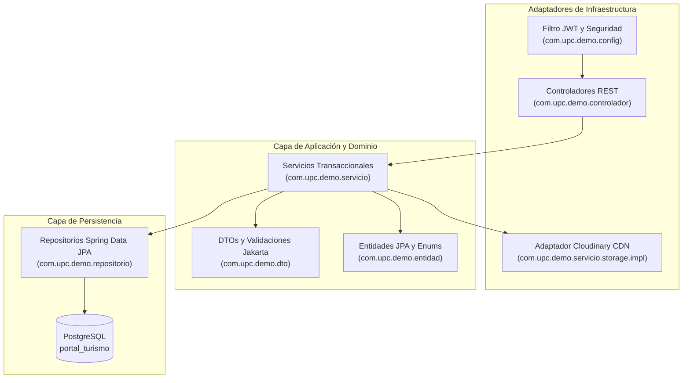

# Arquitectura de Software — Turismo Capilla del Monte

Este documento describe la arquitectura global, los patrones de diseño y la guía técnica para el ecosistema de **Turismo Capilla del Monte**.

> [!TIP]
> Para el catálogo de credenciales y datos de prueba, revisá [docs/test-credentials.md](./test-credentials.md). Para el flujo de negocio y pantallas, consultá el [Manual de Usuario Oficial](./user-manual.md).

---

## 1. Visión General del Sistema

El sistema provee una plataforma integral para la promoción turística y reserva directa de alojamientos en Capilla del Monte, Córdoba, operando bajo un modelo **Multirepo** con contratos de interfaz desacoplados (API-First).

### Componentes Principales

1. **Frontend (`Turismo-Capilla`):**
   * **Aplicaciones:**
     * `apps/portal-turismo`: Portal público orientado a turistas (`http://localhost:5173`).
     * `apps/dashboard`: Panel de gestión oficial para la Comisión y Prestadores (`http://localhost:5174`).
   * **Framework:** React 19.3 + Vite 8 (Rolldown) + React Router v7.
   * **Estilos & UI:** Tailwind CSS v4 con tokens de diseño serranos (Terracota, Brote Uritorco, Sand).
   * **Arquitectura:** Single Page Application (SPA) pura conforme a los requerimientos pedagógicos de la cátedra de **Programación III** (sin meta-frameworks SSR como Astro/Next.js).
   * **Estrategia SEO:** Mitigación mediante marcado estructurado Schema.org (JSON-LD `TouristDestination`), metadatos canónicos OpenGraph y optimización extrema de Core Web Vitals.
   * **Mapas & Animaciones:** Leaflet para geolocalización interactiva y GSAP para micro-interacciones de la Landing Page.

2. **Backend (`backend-capilla-turismo`):**
   * **Stack:** Java 17 (LTS) + Spring Boot 3 + Spring Data JPA (Hibernate) + PostgreSQL.
   * **Gestor de Dependencias y Build:** Apache Maven (`mvnw`).
   * **Autenticación & Seguridad:** Spring Security 6 con tokens JWT stateless y control de acceso basado en roles (`ROLE_TOURIST`, `ROLE_HOST`, `ROLE_ADMIN`).
   * **Persistencia:** Hibernate como proveedor de JPA, con pool de conexiones HikariCP y soporte para transacciones ACID estrictas (`@Transactional`).
   * **Almacenamiento Multimedia:** Adaptador desacoplado `StorageService` con implementación en la nube `CloudinaryStorageService` (SDK Cloudinary) que optimiza y distribuye fotos mediante CDN sin exponer credenciales en el cliente.
   * **Documentación Interactiva:** Springdoc OpenAPI / Swagger UI en `/swagger-ui.html`.

---

## 2. Patrón de Arquitectura: Hexagonal y en Capas (Spring Boot)

El backend en Java implementa una **Arquitectura en Capas / Modular** para aislar el modelo de negocio de los detalles de infraestructura:



### Estructura de Paquetes Canónica

```text
src/main/java/com/upc/demo/
├── config/             # Seguridad Spring Security, JWT Filter, OpenAPI, CORS y Logger
│   ├── exception/      # GlobalExceptionHandler y excepciones semánticas (BadRequest, Conflict, Forbidden)
│   └── DotEnvEnvironmentPostProcessor.java
├── controlador/        # Controladores REST (/api/v1/*)
│   ├── AccommodationController.java
│   ├── AlertController.java
│   ├── AttractionController.java
│   ├── AuthController.java
│   ├── BookingController.java
│   ├── EventController.java
│   ├── InvitationsController.java
│   ├── MediaController.java
│   └── UsersController.java
├── dto/                # Data Transfer Objects agrupados por módulo y validados con Jakarta
├── entidad/            # Entidades JPA del dominio y tipos enumerados
│   ├── enums/          # Role, AccommodationType, AttractionCategory, BookingStatus, AlertSeverity
│   ├── Accommodation.java
│   ├── AccommodationImage.java
│   ├── Alert.java
│   ├── Attraction.java
│   ├── Booking.java
│   ├── Event.java
│   ├── InvitationToken.java
│   ├── RatePlan.java
│   ├── RoomType.java
│   └── User.java
├── repositorio/        # Interfaces Spring Data JPA con consultas JPQL especializadas
└── servicio/           # Servicios transaccionales y lógica de negocio
    ├── storage/        # Interfaz agnóstica StorageService y adaptadores (Cloudinary / Local)
    ├── AccommodationService.java
    ├── AlertService.java
    ├── AttractionService.java
    ├── AuthService.java
    ├── BookingService.java
    ├── EventService.java
    ├── InvitationService.java
    └── UserService.java
```

---

## 3. Modelo de Dominio y Reglas de Negocio Clave

### 3.1 Motor de Reservas y Prevención de Overbooking
* Una reserva atraviesa los estados: `PENDING` (solicitada), `CONFIRMED` (aprobada por el cabañero tras verificar seña), `CANCELLED` (cancelada) y `COMPLETED` (estadía finalizada tras check-out).
* **Invariante de Negocio Crítica:** Dos reservas no pueden solaparse en un mismo alojamiento para un mismo rango de fechas si ambas están en estado `PENDING` o `CONFIRMED`:
  $$\text{checkIn}_{\text{existente}} < \text{checkOut}_{\text{solicitado}} \quad \land \quad \text{checkOut}_{\text{existente}} > \text{checkIn}_{\text{solicitado}}$$
* La comprobación y persistencia ocurren dentro de una transacción atómica `@Transactional(isolation = Isolation.READ_COMMITTED)`. Si existe solapamiento, se arroja `ConflictException` (HTTP 409).

### 3.2 Seguridad de Medios y Cloudinary
* La carga multimedia se realiza estrictamente en el backend (`/api/v1/media/upload`).
* El frontend **nunca** almacena ni tiene acceso al `api_secret` de Cloudinary.
* El backend valida formato binario (`image/jpeg`, `image/png`, `image/webp`), limita el peso a 5 MB, aplica transformación webp y auto-calidad, y retorna el `publicId` y la URL segura HTTPS de CDN.

### 3.3 Régimen de Suspensión Municipal de Prestadores
* Los prestadores pueden ser suspendidos preventivamente por la Comisión (`UsersController.toggleSuspension`).
* La suspensión actualiza `isActive = false` en `User`, lo que provoca:
  1. Denegación inmediata de inicio de sesión con `ForbiddenException` (HTTP 403).
  2. Filtrado automático en las consultas públicas de catálogo de alojamientos (`a.host.isActive = true`).
