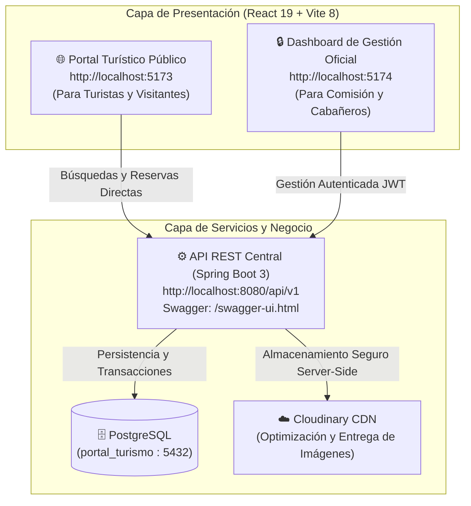
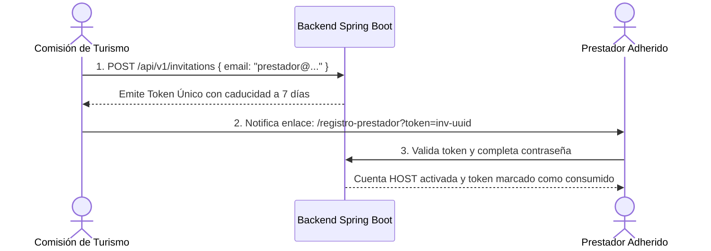
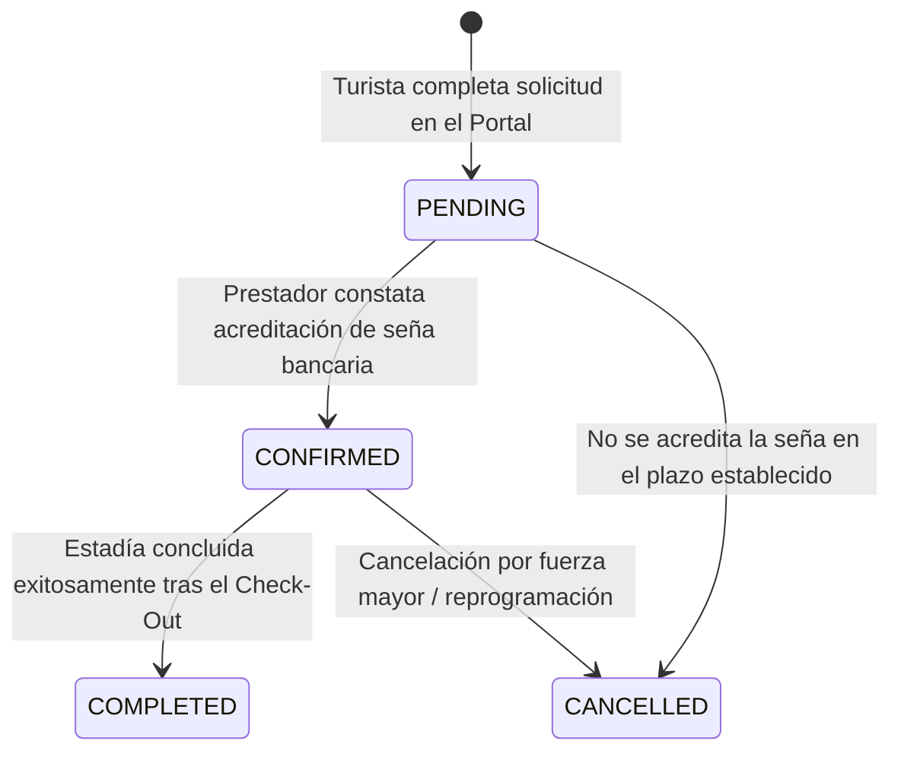

# Manual de Usuario Oficial — Plataforma Turismo Capilla del Monte

  <strong>Secretaría y Comisión de Turismo de Capilla del Monte, Córdoba, Argentina</strong> 
  Plataforma Integral de Promoción de Destino, Catálogo de Prestadores y Motor de Reservas Directas

---

## 📖 Índice General

1. [Introducción y Objetivos Estratégicos](#1-introducción-y-objetivos-estratégicos)
2. [Ecosistema de Aplicaciones y Enlaces Rápidos](#2-ecosistema-de-aplicaciones-y-enlaces-rápidos)
3. [Seguridad, Credenciales Oficiales y Control de Acceso (RBAC)](#3-seguridad-credenciales-oficiales-y-control-de-acceso-rbac)
4. [Módulo de Perfil de Usuario y Cambio de Contraseña](#4-módulo-de-perfil-de-usuario-y-cambio-de-contraseña)
5. [Manual del Administrador (Comisión de Turismo)](#5-manual-del-administrador-comisión-de-turismo)
   - 5.1. [Centro de Control y Métricas del Destino (Overview)](#51-centro-de-control-y-métricas-del-destino-overview)
   - 5.2. [Directorio de Prestadores y Régimen de Suspensión](#52-directorio-de-prestadores-y-régimen-de-suspensión)
   - 5.3. [Tokens de Invitación Oficial para Prestadores](#53-tokens-de-invitación-oficial-para-prestadores)
   - 5.4. [Gestión de Atractivos, Senderos y Balnearios](#54-gestión-de-atractivos-senderos-y-balnearios)
   - 5.5. [Sistema de Alertas Meteorológicas y Defensa Civil](#55-sistema-de-alertas-meteorológicas-y-defensa-civil)
   - 5.6. [Agenda Cultural y Eventos del Pueblo](#56-agenda-cultural-y-eventos-del-pueblo)
   - 5.7. [Calendario Oficial de Temporadas y Tarifas de Referencia](#57-calendario-oficial-de-temporadas-y-tarifas-de-referencia)
   - 5.8. [Auditoría y Trazabilidad Municipal](#58-auditoría-y-trazabilidad-municipal)
6. [Manual del Cabañero / Prestador Turístico](#6-manual-del-cabañero--prestador-turístico)
   - 6.1. [Alta e Incorporación mediante Token de Invitación](#61-alta-e-incorporación-mediante-token-de-invitación)
   - 6.2. [Administración de Cabañas y Hospedajes (Ficha y Servicios)](#62-administración-de-cabañas-y-hospedajes-ficha-y-servicios)
   - 6.3. [Inventario Multi-unidad (Habitaciones y Planes de Tarifa)](#63-inventario-multi-unidad-habitaciones-y-planes-de-tarifa)
   - 6.4. [Galería de Fotos y Carga Optimizada en Cloudinary](#64-galería-de-fotos-y-carga-optimizada-en-cloudinary)
   - 6.5. [Configuración de Señas y Datos Bancarios (CBU / Alias)](#65-configuración-de-señas-y-datos-bancarios-cbu--alias)
   - 6.6. [Gestión de Solicitudes y Máquina de Estados de Reservas](#66-gestión-de-solicitudes-y-máquina-de-estados-de-reservas)
   - 6.7. [Calendario de Disponibilidad y Bloqueos de Fechas](#67-calendario-de-disponibilidad-y-bloqueos-de-fechas)
   - 6.8. [Rendimiento Comercial y Métricas de Ocupación](#68-rendimiento-comercial-y-métricas-de-ocupación)
7. [Guía para el Turista (Portal Web Público)](#7-guía-para-el-turista-portal-web-público)
   - 7.1. [Exploración de Atractivos y Circuitos Serranos en Mapa](#71-exploración-de-atractivos-y-circuitos-serranos-en-mapa)
   - 7.2. [Búsqueda con Filtros por Fechas Libres (Anti-Overbooking)](#72-búsqueda-con-filtros-por-fechas-libres-anti-overbooking)
   - 7.3. [Flujo de Reserva Directa y Cálculo Automático de Seña](#73-flujo-de-reserva-directa-y-cálculo-automático-de-seña)
   - 7.4. [Consulta Pública de Reserva por Código CAP y Voucher](#74-consulta-pública-de-reserva-por-código-cap-y-voucher)
8. [Resolución de Incidencias y Preguntas Frecuentes](#8-resolución-de-incidencias-y-preguntas-frecuentes)

---

## 1. Introducción y Objetivos Estratégicos

La plataforma **Turismo Capilla del Monte** es un desarrollo tecnológico integral creado para la **Comisión y Secretaría de Turismo de Capilla del Monte**, con los siguientes pilares de impacto:

* **Promoción Oficial del Destino:** Difundir la riqueza natural, cultural y mística de Capilla del Monte (Cerro Uritorco, Los Terrones, El Zapato, Dique El Cajón, Balneario La Toma, Los Mogotes) con información certera, mapas interactivos y fotografías verificadas.
* **Canal Directo de Reservas sin Comisiones Extranjeras:** Conectar al turista directamente con el prestador hotelero y cabañero local, reduciendo intermediarios y garantizando pagos de señas trazables mediante transferencia bancaria (CBU / Alias).
* **Integridad Transaccional Anti-Overbooking:** Mecanismo algorítmico estricto que previene la sobreventa de una misma unidad de alojamiento para rangos de fechas coincidentes (`checkIn < existingCheckOut && checkOut > existingCheckIn`).
* **Gobernanza Municipal:** Brindar a la Comisión de Turismo herramientas para habilitar prestadores homologados mediante tokens auditados, suspender preventivamente establecimientos no regularizados, monitorear la ocupación hotelera del pueblo y coordinar alertas de Defensa Civil.

---

## 2. Ecosistema de Aplicaciones y Enlaces Rápidos

El sistema opera mediante dos aplicaciones frontend SPA integradas que consumen la misma API REST central y base de datos relacional:

| Aplicación | Enlace Local | Destinatarios | Responsabilidad |
| :--- | :--- | :--- | :--- |
| **Portal Turístico** | [http://localhost:5173](http://localhost:5173) | Turistas / Público General | Landing promocional, catálogo de paseos, filtros de cabañas, motor de reservas y consulta de estado de estadía. |
| **Dashboard de Gestión** | [http://localhost:5174](http://localhost:5174) | Comisión Municipal y Prestadores | Panel administrativo protegido por autenticación JWT y roles estrictos (RBAC). |
| **API REST & Swagger UI** | [http://localhost:8080/swagger-ui.html](http://localhost:8080/swagger-ui.html) | Desarrolladores / Auditores | Documentación interactiva de endpoints y contratos OpenAPI. |

---

## 3. Seguridad, Credenciales Oficiales y Control de Acceso (RBAC)

La plataforma cuenta con **Control de Acceso Basado en Roles (RBAC estricto)** implementado en el backend mediante Spring Security y en el cliente mediante enrutadores protegidos (`useDashboardRouter` y `sanitizeTabForRole`). 

> [!IMPORTANT]
> Un usuario no puede alterar su rol en el cliente. El acceso a cada pestaña está condicionado por el token criptográfico JWT emitido por la API al autenticarse.

### 3.1 Cuentas Sembradas de Prueba
Para pruebas de auditoría, consultar el detalle exhaustivo en [docs/test-credentials.md](./test-credentials.md):

* **Comisión de Turismo (`ADMIN`):** `admin@capilladelmonte.gov.ar` | Clave: `AdminCapilla2026!`
* **Cabañero / Prestador 1 (`HOST`):** `host@capilladelmonte.gov.ar` | Clave: `HostCapilla2026!` (*Cabañas Pircas del Uritorco*)
* **Cabañero / Prestador 2 (`HOST`):** `marcela.rossi@capillaturismo.com.ar` | Clave: `HostCapilla2026!` (*Hostería Boutique Los Nogales - Multiunidad*)
* **Cabañero / Prestador 3 (`HOST`):** `carlos.benitez@capillaturismo.com.ar` | Clave: `HostCapilla2026!` (*Refugio Los Alazanes*)

### 3.2 Inicio de Sesión Rápido
1. Ingrese a `http://localhost:5174`.
2. Para agilizar las pruebas, haga clic en los botones de **"Comisión (Admin)"** o **"Cabañero (Host)"** situados debajo del formulario para autocompletar las credenciales.
3. Presione **"Ingresar al Sistema"**. El sistema lo redirigirá inmediatamente al módulo correspondiente a su rol.

---

## 4. Módulo de Perfil de Usuario y Cambio de Contraseña

Tanto los miembros de la Comisión como los prestadores pueden acceder a su configuración personal:
1. Haga clic en su **Avatar de Iniciales** en la esquina superior derecha o en el menú lateral.
2. Seleccione **"Mi Perfil y Seguridad"** (`/perfil`).

* **Datos Personales:** Nombre, apellido y teléfono de contacto con validación en tiempo real.
* **Correo Electrónico (Protegido):** En modo solo lectura, al ser el identificador único institucional.
* **Modificación de Contraseña:** Exige la contraseña actual (comprobada contra BCrypt), nueva clave (mínimo 8 caracteres) y confirmación coincidente.

### 4.3 Recuperación Autónoma de Contraseña mediante Código OTP
Si un prestador o administrador olvidó su clave de acceso:
1. En la pantalla de inicio de sesión (http://localhost:5174), hacer clic en **"¿Olvidaste tu contraseña?"** debajo del campo de contraseña.
2. **Paso 1 (Solicitud de Código):** Ingresar el correo electrónico registrado y presionar **"Enviar Código"**. El sistema emite un código numérico temporal de 6 dígitos con validez estricta de 15 minutos.
3. **Paso 2 (Validación y Restablecimiento):**
   * Ingresar el **código de 6 dígitos** recibido por correo.
   * Cargar la **nueva contraseña** (mínimo 8 caracteres) y su confirmación.
   * Presionar **"Restablecer"**.
4. **Mecanismos de Seguridad Aplicados:**
   * **Defensa Anti-Fuerza Bruta:** Se permite un máximo de 5 intentos fallidos antes de invalidar el código permanentemente.
   * **Protección Anti-Enumeración:** El sistema jamás confirma si un email existe o no en el padrón municipal para prevenir rastreos externos.

---

## 5. Manual del Administrador (Comisión de Turismo)

El rol `ADMIN` está reservado para los funcionarios y coordinadores de la Secretaría de Turismo.

### 5.1. Centro de Control y Métricas del Destino (Overview)
Ruta: `/overview`
* **KPIs Clave:** Total de reservas gestionadas en el pueblo, tasa de ocupación promedio, complejos adheridos activos y alertas críticas.
* **Alertas del Destino:** Notificaciones en tiempo real emitidas por Defensa Civil o Bomberos.
* **Auditoría de Reservas Recientes:** Monitoreo de códigos `CAP-YYYY-XXXX` emitidos por los turistas.

### 5.2. Directorio de Prestadores y Régimen de Suspensión
Ruta: `/prestadores` o `/directorio`
* **Padrón Homologado:** Listado de todos los prestadores registrados, cantidad de alojamientos, capacidad total de plazas y teléfono de contacto.
* **Suspensión Preventiva de Prestador:**
  * Si un establecimiento incumple normas de habilitación municipal o seguridad edilicia, el administrador puede accionar el botón de **"Suspender Prestador"**.
  * **Efectos Automáticos del Sistema al Suspender:**
    1. Bloqueo inmediato del acceso al Dashboard para ese prestador (recibirá un error `403 Forbidden` indicando la suspensión municipal).
    2. Los alojamientos del prestador quedan **automáticamente excluidos del catálogo público** de búsqueda del Portal del Turista.
    3. Ningún turista podrá generar nuevas reservas sobre sus establecimientos.
  * **Levantamiento de Suspensión:** Tras regularizar la situación, el administrador presiona **"Reactivar Prestador"**, restaurando instantáneamente su acceso y visibilidad en el portal.

### 5.3. Tokens de Invitación Oficial para Prestadores
Ruta: `/invitations`

1. Presione **"Generar Token de Invitación"**.
2. Indique el correo electrónico del prestador que completó el trámite municipal.
3. El sistema genera un enlace criptográfico único con 7 días de validez.
4. Puede copiar el enlace o revocar la invitación en caso de error.

### 5.4. Gestión de Atractivos, Senderos y Balnearios
Ruta: `/atractivos` o `/portal_cms`
* **Alta y Edición de Paseos:** Nombre, descripción, categoría (`HILL`, `RIVER_BEACH`, `CULTURAL`, `NATURE_TRAIL`, `NIGHT`), nivel de dificultad, duración estimada y coordenadas GPS.
* **Gestión de Estados Operativos:**
  * `OPEN` (Abierto al público).
  * `WEATHER_RESTRICTED` (Restringido por condiciones climáticas, ej. crecidas en Balneario La Toma).
  * `CLOSED` (Cerrado por mantenimiento o riesgo de derrumbe).
* **Galería de Imágenes:** Fotos de alta resolución vinculadas al paseo.

### 5.5. Sistema de Alertas Meteorológicas y Defensa Civil
Ruta: `/alertas`
* Emisión de avisos urgentes (ej. *Riesgo Extremo de Incendios Forestales*, *Crecida del Río Calabalumba*).
* Selección de severidad: `INFO`, `WARNING`, `DANGER`.
* Impacto inmediato: Se despliega una barra de advertencia destacada en el Portal Turístico público con enlace directo al protocolo de prevención.

### 5.6. Agenda Cultural y Eventos del Pueblo
Ruta: `/events`
* Publicación del cronograma oficial: Festival del Alienígena, Noche de Astroturismo, Ferias de Artesanos.
* Definición de fecha/hora, ubicación física (Calle Techada, Predio Gabriel Suárez, Plaza San Martín) y valor de la entrada o acceso libre.

### 5.7. Calendario Oficial de Temporadas y Tarifas de Referencia
Ruta: `/settings`
* Delimitación de fechas de **Temporada Alta** (Enero, Febrero, Julio), **Temporada Media** y **Temporada Baja**.
* Fijación de tarifas de referencia para orientar al sector hotelero y prevenir la especulación de precios.

### 5.8. Auditoría y Trazabilidad Municipal
Ruta: `/audit`
* Registro inmutable de cada acción relevante efectuada en el sistema: fecha, hora, usuario actor, dirección IP y detalle de la operación (emisión de token, cambio de estado de reserva, modificación de tarifas).

---

## 6. Manual del Cabañero / Prestador Turístico

El rol `HOST` está destinado a los propietarios, administradores y recepcionistas de complejos turísticos.

### 6.1. Alta e Incorporación mediante Token de Invitación
1. El prestador recibe el enlace provisto por la Comisión de Turismo:  
   `http://localhost:5174/registro-prestador?token=inv-<uuid>`
2. Completa su nombre, apellido, teléfono y crea una contraseña segura de al menos 8 caracteres.
3. El sistema valida el token de un solo uso y le otorga acceso instantáneo al panel operativo.

### 6.2. Administración de Cabañas y Hospedajes (Ficha y Servicios)
Ruta: `/accommodations`
* **Ficha Técnica:** Nombre comercial, descripción atractiva, dirección exacta, localidad y coordenadas.
* **Comodidades y Atributos:** Selección visual de amenidades (Piscina climatizada, Wi-Fi Starlink, Asador individual, Cochera techada, Aire acondicionado, Pet friendly).
* **Régimen de Desayuno:** Especificación de si incluye desayuno y de qué tipo (*"Desayuno serrano casero"*).

### 6.3. Inventario Multi-unidad (Habitaciones y Planes de Tarifa)
Para establecimientos con múltiples unidades (hoteles, hosterías boutique, apart-hoteles como *Hostería Boutique Los Nogales*):
* Permite dar de alta **Tipos de Habitación** (ej. Standard Doble, Superior, Suite con Jacuzzi).
* Cada tipo define: unidades totales en stock, capacidad base y máxima, camas y amenities específicas.
* **Planes de Tarifa:** Asociación de planes diferenciados por tipo de habitación (ej. *Tarifa Flexible con cancelación gratuita* vs *Tarifa con Desayuno Serrano incluido*).

### 6.4. Galería de Fotos y Carga Optimizada en Cloudinary
* La carga de imágenes se realiza mediante selector de archivos o drag & drop.
* **Validaciones del Sistema:** Formatos permitidos `image/jpeg`, `image/png`, `image/webp` con un peso máximo de 5 MB por imagen.
* **Optimización Automática:** El backend procesa las imágenes con el SDK de Cloudinary aplicando auto-calidad, compresión webp y límite de resolución a 1920x1080 px para garantizar una carga ultrarrápida al turista.
* **Foto de Portada:** Permite designar una foto principal (`isMain`) que encabezará la tarjeta en el catálogo.

### 6.5. Configuración de Señas y Datos Bancarios (CBU / Alias)
Para percibir los anticipos de reserva directamente en su cuenta bancaria:
* **Porcentaje de Seña Exigido:** Configurable (ej. 30%, 40% o 50% del valor total).
* **Entidad Bancaria / Proveedor:** Banco Nación, Santander, Galicia, Mercado Pago, etc.
* **CBU / CVU:** Clave Bancaria Uniforme de 22 dígitos.
* **Alias de Transferencia:** Identificador alfanumérico (ej. `PIRCAS.URITORCO.RIO`).
* **Nombre del Titular:** Para que el turista verifique el destinatario al realizar la transferencia.

### 6.6. Gestión de Solicitudes y Máquina de Estados de Reservas
Ruta: `/reservas` o `/bookings`

* **Bandeja de Entrada:** Listado ordenado de solicitudes con código único auditado (`CAP-YYYY-XXXX`), nombre del huésped, fechas de Check-In/Check-Out, monto total y anticipo requerido.
* **Confirmación de Reserva:** Al verificar la acreditación bancaria en su cuenta, el prestador hace clic en **"Confirmar Reserva"**.
* **Cancelación con Motivo:** Si el pago no fue enviado o existió un inconveniente de fuerza mayor, puede cancelar la reserva especificando el motivo.

### 6.7. Calendario de Disponibilidad y Bloqueos de Fechas
Ruta: `/calendar`
* Grilla mensual interactiva con noches ocupadas y libres.
* **Bloqueo Manual de Fechas:** Permite inhabilitar días específicos por refacciones, pintura o reservas telefónicas directas, garantizando que el portal no acepte reservas en esos días.

### 6.8. Rendimiento Comercial y Métricas de Ocupación
Ruta: `/performance`
* Porcentaje de ocupación mensual y proyección de ingresos brutos por señas cobradas.
* Promedio de noches por estadía y procedencia de visitantes.

---

## 7. Guía para el Turista (Portal Web Público)

El portal público ([http://localhost:5173](http://localhost:5173)) está optimizado para una navegación veloz, accesible y sin fricciones.

### 7.1. Exploración de Atractivos y Circuitos Serranos en Mapa
* Sección **"Atractivos"**: Fichas técnicas de los paseos más destacados de Capilla del Monte con fotografías, niveles de dificultad física y duración.
* Mapa interactivo de Leaflet con la ubicación exacta de cada atractivo y estado de transitabilidad en tiempo real.

### 7.2. Búsqueda con Filtros por Fechas Libres (Anti-Overbooking)
1. En el buscador principal, el turista define:
   * **Fecha de Llegada (Check-In)**
   * **Fecha de Salida (Check-Out)**
   * **Cantidad de Huéspedes**
2. El sistema aplica el filtro algorítmico y muestra **únicamente los establecimientos que tienen disponibilidad efectiva y cuyos prestadores no estén suspendidos**.

### 7.3. Flujo de Reserva Directa y Cálculo Automático de Seña
1. El turista ingresa al detalle del alojamiento y presiona **"Solicitar Reserva"**.
2. Completa su nombre, apellido, correo electrónico y teléfono celular.
3. El sistema desglosa con total transparencia:
   * Precio por noche.
   * Cantidad total de noches.
   * Importe final de la estadía.
   * **Monto exacto de la seña anticipada** (calculada con el porcentaje fijado por el prestador).
   * Datos de la cuenta bancaria (CBU, Alias y Titular) para realizar la transferencia.
4. Al confirmar, el sistema genera el **Código Oficial de Reserva** con formato `CAP-YYYY-XXXX`.

### 7.4. Consulta Pública de Reserva por Código CAP y Voucher
El turista no requiere recordar claves ni registrarse:
1. En el menú superior del portal, hace clic en **"Consultar Mi Reserva"**.
2. Ingresa su **Código de Reserva (`CAP-...`)** y su **Correo Electrónico**.
3. El sistema despliega el **Voucher Oficial de Estadía** con el estado en tiempo real (`PENDING`, `CONFIRMED`, `COMPLETED`), la dirección exacta y los canales de contacto del prestador.

---

## 8. Resolución de Incidencias y Preguntas Frecuentes

### ¿Qué ocurre si un prestador intenta acceder a módulos de la Comisión Municipal?
El enrutador inteligente de seguridad intercepta la navegación no autorizada y lo redirige automáticamente a su módulo de reservas (`/reservas`), impidiendo cualquier acceso indebido a datos de otros prestadores o configuraciones municipales.

### ¿Qué sucede cuando un prestador es suspendido por la Comisión?
El prestador recibe un error `403 Forbidden` al intentar autenticarse, explicando que su cuenta se encuentra bajo suspensión municipal. Simultáneamente, sus alojamientos son retirados del catálogo público del portal para proteger a los turistas.

### ¿Las imágenes subidas ralentizan el portal?
No. Todas las fotografías cargadas por los prestadores se envían al almacenamiento en la nube de **Cloudinary**, que las transforma a formato WebP, las comprime automáticamente y las sirve mediante su red global de distribución de contenidos (CDN).

### ¿Cómo recupero mi contraseña si la olvidé?
Por motivos de seguridad, las contraseñas están almacenadas bajo hash irreversible BCrypt. Si perdió el acceso a su cuenta, comuníquese con la Secretaría de Turismo para verificar su identidad y recibir un nuevo token de acceso seguro.

### Canales de Contacto Oficial
* **Secretaría de Turismo de Capilla del Monte:** Pueyrredón esq. Diagonal Buenos Aires, Capilla del Monte, Córdoba.
* **Teléfono de Informes:** `+54 3548 481123`
* **Correo Institucional:** `turismo@capilladelmonte.gov.ar`
