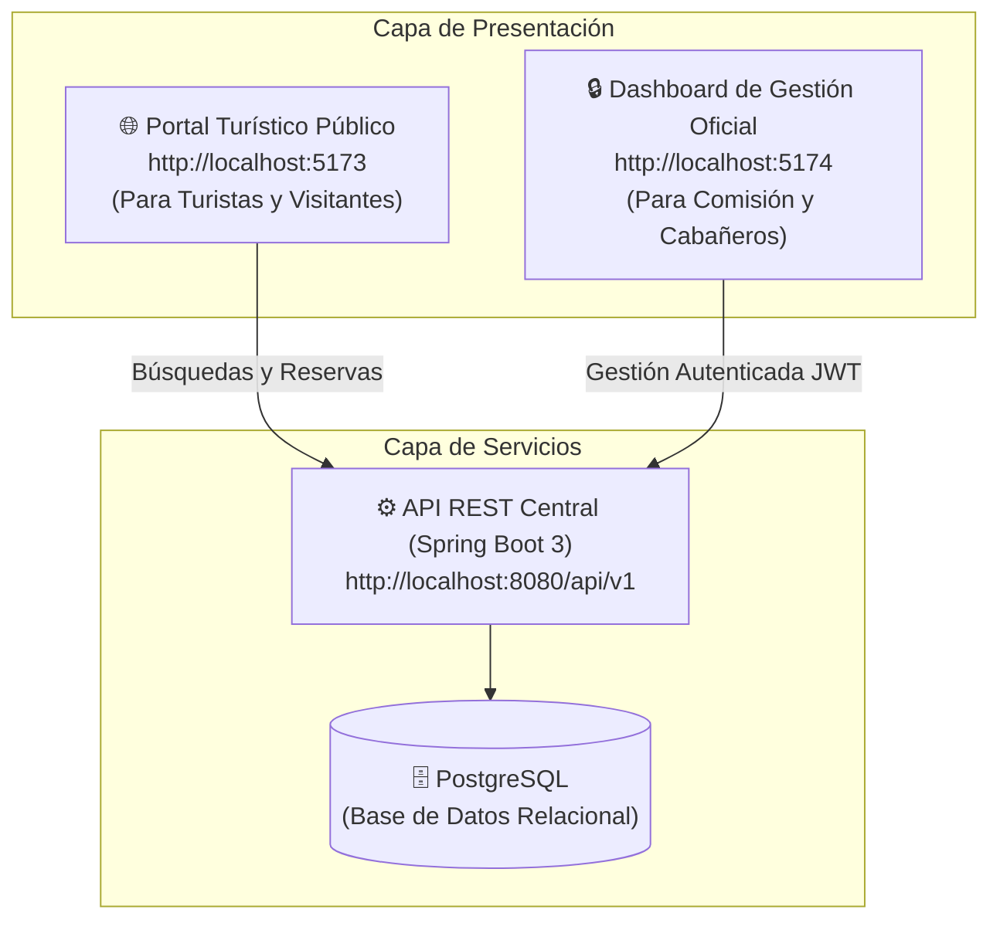
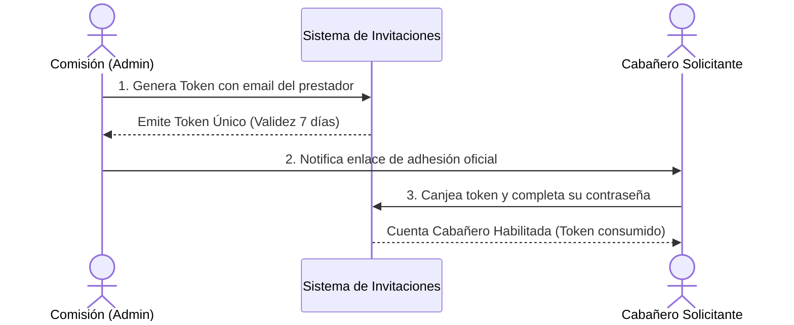
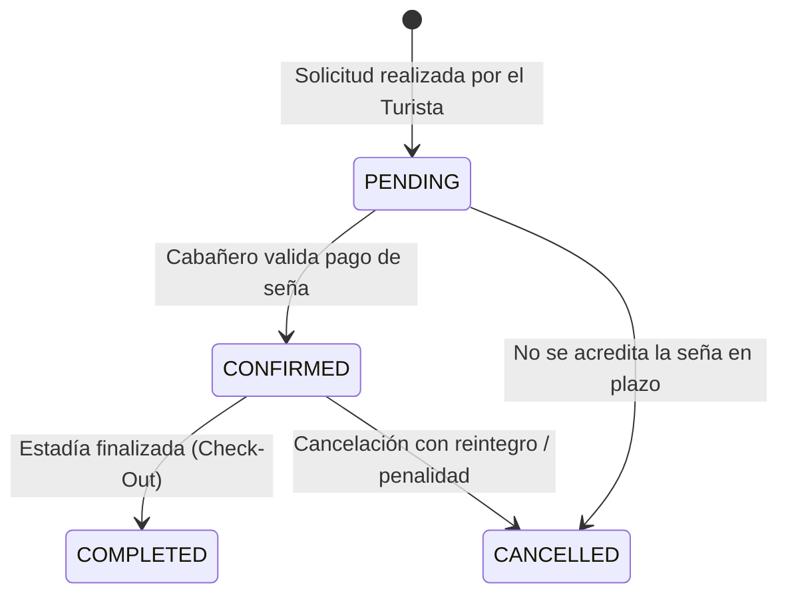

# Manual de Usuario Oficial — Plataforma Turismo Capilla del Monte

  <strong>Secretaría y Comisión de Turismo de Capilla del Monte, Córdoba, Argentina</strong> 
  Plataforma Integral de Promoción de Destino, Catálogo de Prestadores y Motor de Reservas Directas

---

## 📖 Índice General

1. [Introducción y Objetivos](#1-introducción-y-objetivos)
2. [Ecosistema de Aplicaciones y Enlaces Rápidos](#2-ecosistema-de-aplicaciones-y-enlaces-rápidos)
3. [Seguridad, Credenciales Oficiales y Control de Acceso (RBAC)](#3-seguridad-credenciales-oficiales-y-control-de-acceso-rbac)
4. [Módulo de Perfil de Usuario y Cambio de Contraseña](#4-módulo-de-perfil-de-usuario-y-cambio-de-contraseña)
5. [Manual del Administrador (Comisión de Turismo)](#5-manual-del-administrador-comisión-de-turismo)
   - 5.1. [Centro de Control y Métricas del Destino (Overview)](#51-centro-de-control-y-métricas-del-destino-overview)
   - 5.2. [Directorio de Prestadores Adheridos](#52-directorio-de-prestadores-adheridos)
   - 5.3. [Tokens de Invitación para Nuevos Prestadores](#53-tokens-de-invitación-para-nuevos-prestadores)
   - 5.4. [Moderación Visual y Control de Calidad](#54-moderación-visual-y-control-de-calidad)
   - 5.5. [Agenda Cultural y Eventos del Pueblo](#55-agenda-cultural-y-eventos-del-pueblo)
   - 5.6. [Calendario Oficial de Temporadas y Tarifas Sugeridas](#56-calendario-oficial-de-temporadas-y-tarifas-sugeridas)
   - 5.7. [Auditoría y Trazabilidad Municipal](#57-auditoría-y-trazabilidad-municipal)
6. [Manual del Cabañero / Prestador Turístico](#6-manual-del-cabañero--prestador-turístico)
   - 6.1. [Alta e Incorporación mediante Token Oficial](#61-alta-e-incorporación-mediante-token-oficial)
   - 6.2. [Administración de Cabañas y Fotos (Mis Establecimientos)](#62-administración-de-cabañas-y-fotos-mis-establecimientos)
   - 6.3. [Gestión de Solicitudes y Reservas](#63-gestión-de-solicitudes-y-reservas)
   - 6.4. [Calendario de Disponibilidad y Bloqueos de Fechas](#64-calendario-de-disponibilidad-y-bloqueos-de-fechas)
   - 6.5. [Fijación de Tarifas y Estadías Mínimas](#65-fijación-de-tarifas-y-estadías-mínimas)
   - 6.6. [Métricas de Rendimiento del Prestador](#66-métricas-de-rendimiento-del-prestador)
7. [Guía para el Turista (Portal Web Público)](#7-guía-para-el-turista-portal-web-público)
   - 7.1. [Exploración de Atractivos y Circuitos Serranos](#71-exploración-de-atractivos-y-circuitos-serranos)
   - 7.2. [Búsqueda de Alojamientos con Fechas Libres](#72-búsqueda-de-alojamientos-con-fechas-libres)
   - 7.3. [Flujo de Reserva Directa y Cálculo de Seña](#73-flujo-de-reserva-directa-y-cálculo-de-seña)
   - 7.4. [Consulta Pública de Reserva (Código CAP)](#74-consulta-pública-de-reserva-código-cap)
8. [Preguntas Frecuentes y Resolución de Incidencias](#8-preguntas-frecuentes-y-resolución-de-incidencias)

---

## 1. Introducción y Objetivos

La plataforma **Turismo Capilla del Monte** es un desarrollo tecnológico impulsado para la **Comisión de Turismo de Capilla del Monte**, con los siguientes propósitos estratégicos:

* **Promoción Oficial del Destino:** Difundir la riqueza natural, cultural y mística de Capilla del Monte (Cerro Uritorco, Los Terrones, El Zapato, Dique El Cajón, entre otros) con información certera, mapas interactivos y fotografías verificadas.
* **Canal Directo de Reservas sin Comisiones Extranjeras:** Conectar al turista directamente con el prestador hotelero y cabañero local, reduciendo intermediarios abusivos y garantizando pagos de señas trazables.
* **Integridad Transaccional Anti-Overbooking:** Mecanismo algorítmico que previene la sobreventa de una misma unidad de alojamiento para rangos de fechas coincidentes.
* **Gobernanza Municipal:** Brindar a la Comisión de Turismo herramientas para habilitar prestadores homologados mediante tokens auditados, monitorear la ocupación hotelera del pueblo y regular la agenda cultural.

---

## 2. Ecosistema de Aplicaciones y Enlaces Rápidos

El sistema opera mediante dos aplicaciones web integradas que comparten la misma base de datos central:

| Aplicación | Dirección Web Local | Destinatarios | Responsabilidad |
| :--- | :--- | :--- | :--- |
| **Portal Turístico** | `http://localhost:5173` | Turistas / Público General | Landing promocional, catálogo de paseos, filtros de cabañas, motor de reservas y consulta de estado de estadía. |
| **Dashboard de Gestión** | `http://localhost:5174` | Comisión Municipal y Prestadores | Panel administrativo protegido por autenticación JWT y roles estrictos (RBAC). |
| **API REST & Swagger UI** | `http://localhost:8080/swagger-ui.html` | Desarrolladores / Auditores | Documentación interactiva de endpoints y contratos de datos. |

---

## 3. Seguridad, Credenciales Oficiales y Control de Acceso (RBAC)

La plataforma cuenta con **Control de Acceso Basado en Roles (RBAC estricto)** implementado tanto en el backend mediante Spring Security como en el frontend mediante enrutadores protegidos (`sanitizeTabForRole`). 

> [!IMPORTANT]
> Un usuario no puede alterar su rol en el cliente. El acceso a cada pestaña está condicionado por el token criptográfico JWT emitido por la API al iniciar sesión.

### 3.1 Credenciales Oficiales de Demostración y Pruebas

Para facilitar la evaluación y auditoría del sistema, se han creado y poblado de manera automática en la base de datos dos cuentas operativas:

| Perfil / Rol | Correo Electrónico | Contraseña Oficial | Panel de Ingreso | Permisos Clave |
| :--- | :--- | :--- | :--- | :--- |
| **Comisión de Turismo (`ADMIN`)** | `admin@capilladelmonte.gov.ar` | `AdminCapilla2026!` | `/overview` *(Centro de Control)* | Acceso total a invitaciones, prestadores, agenda de eventos, moderación, reportes y calendario de temporadas. |
| **Cabañero / Prestador (`HOST`)** | `host@capilladelmonte.gov.ar` | `HostCapilla2026!` | `/reservas` *(Panel Operativo)* | Gestión de sus cabañas asignadas (*"Pircas del Uritorco"*), tarifas, fotos, bloqueos de fechas y reservas recibidas. |

### 3.2 Inicio de Sesión Rápido

1. Ingrese a `http://localhost:5174` desde cualquier navegador moderno.
2. Si no posee sesión activa, visualizará el formulario oficial de inicio de sesión.
3. Para agilizar las pruebas, haga clic en los botones de **"Comisión (Admin)"** o **"Cabañero (Host)"** situados debajo del formulario. El sistema autocompletará las credenciales seguras.
4. Presione **"Ingresar al Sistema"**. El sistema lo redirigirá inmediatamente al módulo correspondiente a su rol.

---

## 4. Módulo de Perfil de Usuario y Cambio de Contraseña

Tanto los miembros de la Comisión como los Cabañeros pueden acceder a su centro de configuración personal:

1. Haga clic en su **Avatar de Iniciales** ubicado en la esquina superior derecha o en la tarjeta de perfil del menú lateral.
2. Seleccione la opción **"Mi Perfil y Seguridad"** (o navegue directamente a la ruta `/perfil`).

### 4.1 Datos Personales de Contacto
* **Nombre y Apellido:** Pueden editarse para mantener actualizada la identidad visible en las comunicaciones oficiales.
* **Teléfono de Contacto:** Permite cargar el número de WhatsApp o línea directa para contacto operativo.
* **Correo Electrónico (Protegido):** Se muestra en modo de solo lectura, ya que representa la identidad única vinculada al token de habilitación institucional.

### 4.2 Modificación Segura de Contraseña
Para resguardar la cuenta, el formulario de seguridad exige:
* **Contraseña Actual:** Verificada criptográficamente contra el hash BCrypt almacenado en la base de datos.
* **Nueva Contraseña:** Longitud mínima obligatoria de 8 caracteres.
* **Confirmación de Clave:** Chequeo estricto de coincidencia antes de enviar la solicitud.

> [!TIP]
> Utilice el icono del ojo junto a cada campo para visualizar los caracteres ingresados y evitar errores de escritura al definir una nueva clave.

---

## 5. Manual del Administrador (Comisión de Turismo)

El rol `ADMIN` está reservado exclusivamente para los funcionarios y colaboradores de la **Secretaría y Comisión de Turismo**. Al iniciar sesión, la barra de navegación lateral izquierda exhibe los módulos oficiales de gobernanza.

### 5.1. Centro de Control y Métricas del Destino (Overview)
El **Centro de Control** (`/overview`) constituye la pantalla principal del administrador:
* **KPIs Clave:** Indicadores en tiempo real sobre total de reservas gestionadas en el destino, tasa promedio de ocupación turística, establecimientos adheridos y alertas operativas.
* **Alertas del Destino:** Avisos tempranos sobre emergencias hídricas, riesgo extremo de incendios en zonas serranas o alertas meteorológicas para excursionistas.
* **Últimas Reservas Auditadas:** Listado resumido con los códigos `CAP-YYYY-XXXX` generados recientemente en la plataforma.

### 5.2. Directorio de Prestadores Adheridos
En el módulo **Prestadores Adheridos** (`/accommodations`):
* Se listan todos los complejos turísticos habilitados en Capilla del Monte.
* El administrador puede inspeccionar la ficha completa de cada cabañero, verificar su dirección, coordenadas geográficas, capacidad máxima de plazas y datos del titular de la cuenta bancaria.
* Permite dar de alta nuevos alojamientos oficiales en caso de convenios especiales.

### 5.3. Tokens de Invitación para Nuevos Prestadores
Para evitar registros anónimos o no habilitados comercialmente en el municipio, los prestadores solo pueden incorporarse mediante **Tokens de Invitación** (`/invitations`):

1. Presione el botón **"Generar Token de Invitación"**.
2. Indique el correo electrónico del prestador habilitado.
3. El sistema emitirá una clave criptográfica de un solo uso con caducidad a los 7 días.
4. El administrador puede copiar el enlace directo o revocar invitaciones vencidas.

### 5.4. Moderación Visual y Control de Calidad
En la pestaña **Moderación de Fotos** (`/moderation`):
* Se auditan las imágenes subidas por los cabañeros antes o después de su publicación.
* La Comisión puede marcar fotografías inadecuadas, con marcas de agua excesivas o que no cumplan con las directrices visuales del pueblo.

### 5.5. Agenda Cultural y Eventos del Pueblo
En el gestor de **Agenda Cultural** (`/events` y `/portal_cms`):
* Publicación de festivales (Festival Alienígena, Fiesta de la Poesía, ferias de artesanos).
* Creación de eventos especificando: Nombre, descripción, fecha/hora de inicio y finalización, lugar físico (ej. Predio Gabriel Suárez, Calle Techada), precio o entrada libre y foto de portada.
* El contenido impacta instantáneamente en la sección cultural del Portal Web del Turista.

### 5.6. Calendario Oficial de Temporadas y Tarifas Sugeridas
En la sección **Temporadas Oficiales** (`/settings`):
* **Definición de Temporadas:** La Comisión establece los rangos oficiales de **Temporada Alta** (Enero, Febrero, Julio), **Temporada Media** y **Temporada Baja**.
* **Tarifas de Referencia:** Carga de valores sugeridos por noche para orientar al sector hotelero y evitar disparidades tarifarias desmedidas en el destino.

### 5.7. Auditoría y Trazabilidad Municipal
En el módulo de **Auditoría** (`/audit`):
* Registro inmutable de cada acción relevante efectuada en el sistema: fecha, hora, usuario actor, dirección IP y detalle del cambio (ej. token emitido, tarifa actualizada, estado de reserva modificado).

---

## 6. Manual del Cabañero / Prestador Turístico

El rol `HOST` está destinado a los dueños, encargados y administradores de complejos de cabañas, hosterías y hoteles formalmente adheridos al portal municipal.

### 6.1. Alta e Incorporación mediante Token Oficial
1. El cabañero recibe el token de invitación provisto por la Comisión de Turismo.
2. Ingresa al enlace de registro oficial, completa su contraseña y confirma sus datos personales.
3. Al finalizar, su cuenta queda inmediatamente autorizada para gestionar su establecimiento.

### 6.2. Administración de Cabañas y Fotos (Mis Establecimientos)
En la sección **Mis Cabañas** (`/accommodations`):
* **Ficha del Complejo:** Permite editar el nombre del establecimiento, descripción atractiva, dirección exacta, capacidad máxima de huéspedes y comodidades (Piscina climatizada, asador, Wi-Fi Starlink, cochera techada, aire acondicionado).
* **Galería de Fotos:** Carga y ordenamiento visual de las fotografías que visualizarán los turistas en el portal.
* **Datos Bancarios:** Nombre del titular y datos de cuenta para que los turistas depositen la seña requerida.

### 6.3. Gestión de Solicitudes y Reservas
En el módulo principal de **Reservas** (`/bookings`):
* **Bandeja de Solicitudes:** Muestra las reservas entrantes con el código único auditado (`CAP-YYYY-XXXX`), datos de contacto del huésped, fechas de Check-In / Check-Out y cantidad de personas.
* **Máquina de Estados de la Reserva:**
  * **Pendiente (`PENDING`):** El turista completó la solicitud en el portal y debe acreditar el pago de la seña.
  * **Confirmar (`CONFIRMED`):** Al constatar la acreditación bancaria del anticipo, el cabañero presiona "Confirmar Reserva".
  * **Cancelar (`CANCELLED`):** Si el pago no fue enviado o existió un inconveniente de fuerza mayor.
  * **Completar (`COMPLETED`):** Al finalizar la estadía del huésped tras su Check-Out.

### 6.4. Calendario de Disponibilidad y Bloqueos de Fechas
En el módulo **Calendario** (`/calendar`):
* Malla mensual interactiva que refleja las noches reservadas en verde o terracota.
* **Bloqueo Manual de Fechas:** Permite bloquear días específicos por tareas de mantenimiento, pintura o reservas captadas por vía telefónica directa, asegurando que ningún turista pueda solicitarlas en el portal web.

### 6.5. Fijación de Tarifas y Estadías Mínimas
En el módulo **Tarifas y Temporadas** (`/pricing`):
* Configuración del precio base por noche.
* Requisito de estadía mínima (ej. mínimo 3 noches en fines de semana largos o temporada alta).
* Porcentaje de seña obligatorio (estándar: 50%).

### 6.6. Métricas de Rendimiento del Prestador
En el módulo **Rendimiento** (`/performance`):
* Gráficos sobre el nivel de ocupación mensual de sus plazas.
* Resumen de ingresos brutos proyectados por señas cobradas.
* Promedio de noches por estadía de los turistas que visitan su establecimiento.

---

## 7. Guía para el Turista (Portal Web Público)

El portal público (`http://localhost:5173`) está pensado para ofrecer una experiencia rápida, accesible y libre de complicaciones al visitante.

### 7.1. Exploración de Atractivos y Circuitos Serranos
* La pestaña **"Atractivos"** permite descubrir senderos y paseos clasificados por categoría: Cerros, Balnearios y Ríos, Cultural y Paseos Nocturnos.
* Cada ficha técnica incluye: nivel de exigencia física, si requiere guía habilitado de montaña, coordenadas GPS, horarios y valor de ingreso si corresponde.

### 7.2. Búsqueda de Alojamientos con Fechas Libres
1. En el buscador del inicio o en la sección **"Alojamientos"**, el turista selecciona:
   * **Fecha de Ingreso (Check-In)**
   * **Fecha de Egreso (Check-Out)**
   * **Cantidad de Huéspedes**
2. El sistema filtra en tiempo real y muestra **únicamente aquellos establecimientos que cuentan con disponibilidad efectiva**, eliminando cualquier riesgo de solapamiento.

### 7.3. Flujo de Reserva Directa y Cálculo de Seña
1. El turista selecciona la cabaña de su preferencia y presiona **"Solicitar Reserva"**.
2. Completa sus datos de contacto: Nombre, Apellido, Correo Electrónico y Teléfono celular.
3. El sistema desglosa con total transparencia:
   * Valor por noche.
   * Total de noches calculadas.
   * Importe total de la estadía.
   * **Monto exacto de la seña anticipada (50%)** a transferir para asegurar la plaza.
4. Al confirmar la solicitud, el sistema emite el **Código Oficial de Reserva** con formato `CAP-YYYY-XXXX` (ejemplo: `CAP-2026-0042`).

### 7.4. Consulta Pública de Reserva (Código CAP)
El turista no necesita recordar contraseñas para verificar el estado de su viaje:
1. En la barra superior del portal, hace clic en **"Consultar Mi Reserva"**.
2. Ingresa su **Código de Reserva (`CAP-...`)** y su **Correo Electrónico**.
3. El portal despliega el voucher oficial con el estado en tiempo real (`Pendiente`, `Confirmada`, `Completada`), la dirección del complejo y los datos de contacto del cabañero.

---

## 8. Preguntas Frecuentes y Resolución de Incidencias

### ¿Qué ocurre si un cabañero intenta ingresar a una sección exclusiva de la Comisión Municipal?
El enrutador inteligente de seguridad (`useDashboardRouter`) intercepta la navegación no autorizada y lo devuelve automáticamente a su panel de gestión de reservas (`/reservas`), previniendo cualquier fuga de información o alteración indebida de configuraciones municipales.

### ¿Cómo se resuelven los feriados puente y temporadas atípicas?
La Comisión de Turismo puede ingresar en cualquier momento al módulo de **Temporadas Oficiales** (`/settings`), crear un nuevo período especial (ejemplo: *"Semana Santa"* o *"Encuentro de Astroturismo"*) y definir las fechas de vigencia. Los prestadores verán reflejado dicho período en su calendario de tarifas.

### ¿Qué debo hacer si olvidé mi contraseña?
Por motivos de seguridad, las contraseñas están almacenadas bajo cifrado irreversibe BCrypt. Comuníquese con la Comisión de Turismo para que el administrador audite su identidad y regenere un token de restablecimiento seguro, o actualice su clave desde el módulo de [Perfil](#4-módulo-de-perfil-de-usuario-y-cambio-de-contraseña) si conserva una sesión iniciada.

### Canales de Contacto Oficial
* **Secretaría de Turismo de Capilla del Monte:** Pueyrredón esq. Diagonal Buenos Aires, Capilla del Monte, Córdoba.
* **Teléfono de Informes:** `+54 3548 481123`
* **Correo Institucional:** `turismo@capilladelmonte.gov.ar`
